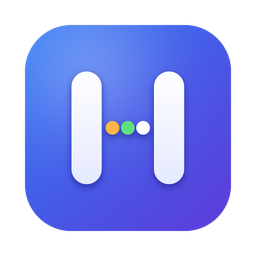

# Holocron

    

A classroom planner for primary school teachers, built as a native Mac app. It started as the planner for one Year 6 class in Victoria, Australia, and is shared here in case it helps other teachers. Light mode, Australian English, and a classic Mac look.

Holocron keeps your fortnightly timetable, lesson summaries, student notes and teaching hours in plain CSV files that you own, so you can back them up, hand-edit them in Numbers, or share the planner part with colleagues.

## What it does

- **Today**: every block of the day in a vertical list, with the current period highlighted, birthdays coming up, and a quote card.
- **Week and Term**: plan a whole fortnight in a grid. Type straight into a slot, drag to swap lessons, change a slot for one day or for every cycle, push or pull lessons when a day is lost, and print the week on one A4 page or save it as a PDF.
- **Class screen**: the lesson name, learning intention, success criteria and a timer, ready for the projector.
- **Students**: a class list and a record for each student with notes, assessments, wellbeing, behaviour, plan notes and a report pack. Photos, birth dates and adjustments are kept on your Mac only.
- **Quick log and Mark class**: log a note for several students at once, or mark the whole class on one task.
- **Hours**: face to face time, release time and duties other than teaching and learning, by term and for the year, including the period lost to wellbeing work.
- **Units and Devotion**: units of inquiry and daily devotion scripts. Every module can be switched off in Settings.

The timetable runs on an A and B fortnightly cycle that restarts each term. Whole days can be marked as camps, carnivals and so on.

## Requirements

macOS 26 or later on a Mac with Apple silicon.

## Install

1. Download the latest `Holocron-x.y-mac.zip` from the [latest release](../../releases/latest). The [changelog](CHANGELOG.md) lists what changed in each version.
2. Unzip it and drag Holocron into your Applications folder.
3. The first time, macOS will not recognise the developer, because the app is not signed with a paid Apple Developer ID. Right-click Holocron, choose **Open**, then **Open** again. It opens normally after that.
4. On first launch, Holocron offers to set up its data folder (see below). It starts you off with a typical school day and a list of subjects. Add your term dates under Settings, then Terms, and adjust the periods and subjects to suit your school.

## Updates

Holocron checks this repository's Releases page when it opens (at most every six hours) and shows a banner when a newer version exists. **Install and restart** downloads it, checks it against its published checksum, swaps it in and reopens the app. You can also use Settings, then Updates, or the Holocron menu, then Check for Updates. If you fork the project, type your own `owner/repository` in Settings, then Updates.

Updates never touch your data, which lives in its own folders.

## Your data

Everything is stored as CSV files in a folder you choose, by default `iCloud Drive/Holocron/data`. There is no account, no server, and no tracking. The only network request the app makes is the update check to GitHub.

The data is split in two folders:

- **Student folder (private)**: students, notes, assessments, wellbeing, behaviour, reports, photos, your hours log, your to-do list and your settings.
- **Planner folder**: the timetable, lessons, terms, units, devotions, quotes, rubrics, subjects and periods. In Settings, then Data, you can point this at a folder shared with colleagues (for example a shared iCloud Drive folder) so a team can share one planner while keeping student records private.

Edit a CSV in Numbers or a text editor, then press Shift+Cmd+R to reload. Files are written safely (to a temporary file, then swapped in), a file that cannot be read is never overwritten, and a warning shows if the data folder is not connected.

To begin again, use **Start over** in Settings, then Data. You can clear just the planner (timetable, lessons, terms, subjects and so on) or everything. The current files are moved into a dated folder in `Holocron archive`, next to the data folder, so nothing is lost. A shared planner folder is only disconnected, never cleared.

**Please check your school's policy** on where student information may be stored before putting any real student data into iCloud Drive or any other service. This repository contains no student data, and the project's `.gitignore` is set up to keep CSV files and photos out of it.

## Build it yourself

1. Open `Holocron.xcodeproj` in Xcode.
2. Press Cmd+R.

The app uses a local (ad hoc) signature, so no developer account is needed. The sandbox is off so the app can reach your iCloud Drive folder. The project has no external dependencies.

Every push to `main` and every pull request is also built on a Mac by GitHub Actions (`.github/workflows/build.yml`). The run checks that no CSV files or photos are in the repository, builds the Release app, checks its signature, and keeps the built app for a week under the run's Artifacts. A red cross next to a commit means the build broke.

### Make it yours

- **Class name**: Settings, then Class. It appears in the sidebar and on exported summaries.
- **Periods, subjects, terms and non-teaching days**: all editable in Settings.
- **Houses and their colours**: `Lists.houseColours` in `Holocron/Core/Schema.swift`.
- **Other lists** (day types, duty types, plan note types, reporting scales): the same file.

## Keyboard shortcuts

Cmd+1 to Cmd+0 jump between screens (Today, Week, Class screen, Term, Units, Devotion, Students, Quick log, Mark class, Hours). Cmd+comma opens Settings. Shift+Cmd+R reloads from the folder. On the Week screen, Cmd+P prints the week and Shift+Cmd+P saves it as a PDF.

## Publishing a release (for maintainers)

Replace `X.Y` with the new version number (for example `1.3`).

1. Commit your changes.
2. Add a `## X.Y` section to `CHANGELOG.md`. Its bullets become the release notes.
3. Commit the changelog, then run `scripts/release.sh X.Y`.

The script needs a clean working tree, so commit everything first.

With the GitHub CLI installed and signed in (`brew install gh`, then `gh auth login`) the script builds, zips, checksums, tags, pushes and creates the release. Without it, the script builds the files into a `dist` folder and prints the steps to publish them from GitHub Desktop and github.com. Either way, running copies of Holocron then offer the update.

The updater only downloads from this repository's release files over HTTPS, requires a matching checksum when one is published, and checks that the new app is Holocron, is newer, and has an intact code signature. The old app is kept until the new one is in place and is put back if anything goes wrong.

## Performance notes

- Schedule questions (what is on in period 3 on this date, which colour is Maths, who is this student) are answered from lookup tables built once per change, not by scanning every row on every redraw.
- Screens are told about changes one table at a time, so typing in a lesson summary redraws the lesson views and leaves the rest alone.
- CSV files are read and written as UTF-8 bytes, and saves happen on a background queue. Quitting and switching folders still wait until everything is on disk.
- Switching back to the app only re-reads files that changed.
- Student photos load as small thumbnails and are cached.

## Licence

Holocron is released under the [MIT Licence](LICENSE). You are free to use, copy, modify and share it, including for your own classroom or school, as long as the licence notice stays with it. It is provided as is, without warranty.

Holocron is an independent personal project. It is not made, endorsed or supported by any school or employer.
